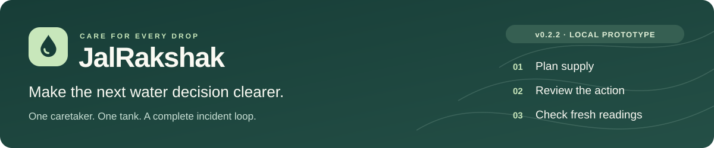
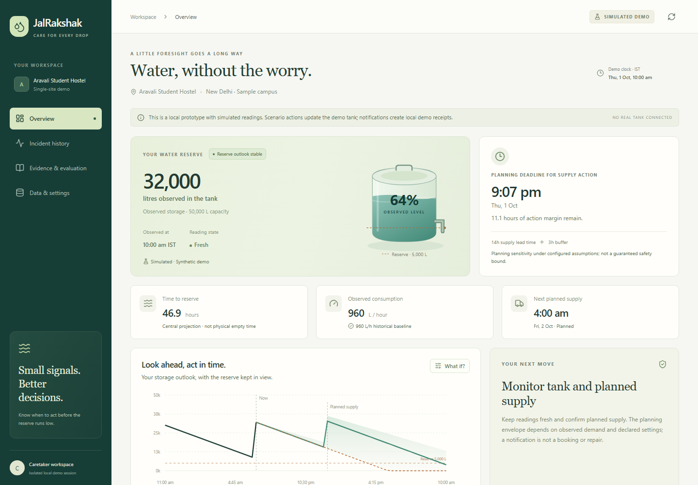
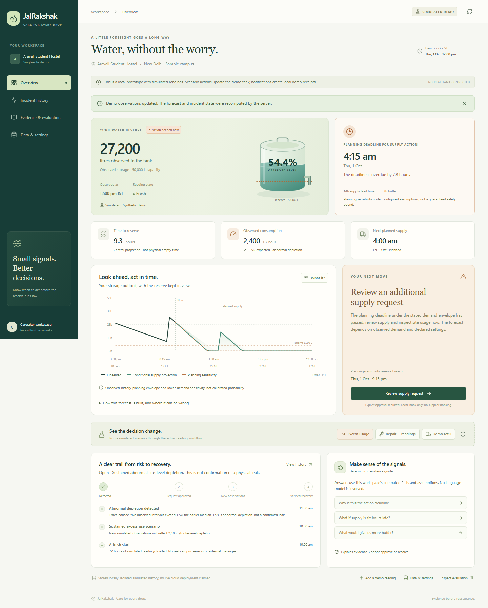
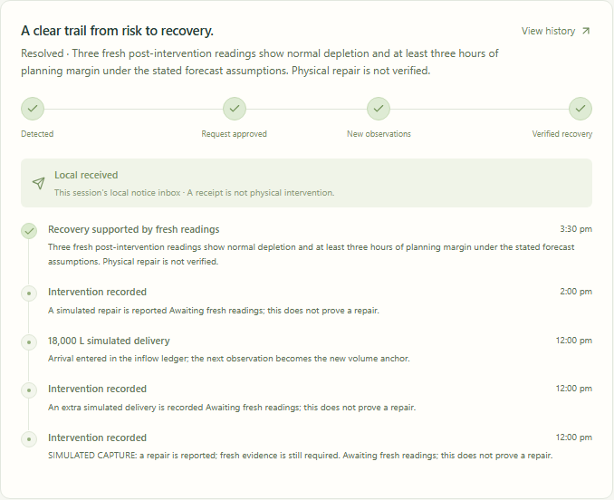
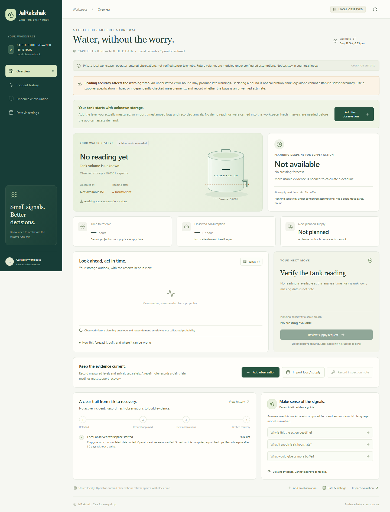
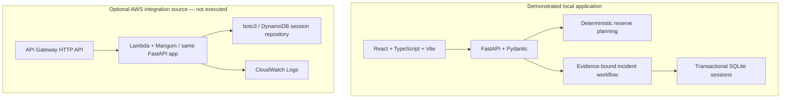

# JalRakshak



[](docs/PROJECT_STATE.md) [](LICENSE) [](https://github.com/Pradhyut21/jalrakshak/actions/runs/38140601260)

**A tank can still contain water when it is already time to arrange the next delivery.** JalRakshak helps one hostel caretaker turn storage readings and supply lead time into a planning deadline, then follow an abnormal-depletion incident through approval and fresh-reading recovery.

**[Watch the 2:54 demo on YouTube](https://youtu.be/zM4BsdQfPdg)** · [Run locally](#quick-start) · [Architecture](#architecture) · [Inspect evidence](#verification-you-can-inspect) · [Project guide](#find-your-way-around)

Working local prototype with a simulated demo and an empty workspace for operator-entered logs. Field usefulness and sensor accuracy remain unvalidated; AWS integration is source/offline-tested only.

[](https://youtu.be/zM4BsdQfPdg)

*Actual interface captured October 11, 2026. Fictional site and simulated readings; the October 1 screen date is the demo clock. [Transcript and provenance](docs/DEMO_VIDEO.md) · [Download the full MP4](docs/media/JalRakshak-Demo.mp4) · [22-second launch clip](docs/media/JalRakshak-Launch.mp4). YouTube playback was verified signed out. Narration is synthetic.*

## One complete incident

| Step | Caretaker action | What the application checks |
|---|---|---|
| **Record** | Enter timestamped tank readings and actual arrivals, or import CSV. | Provenance, units and freshness; observed mode starts empty. |
| **Plan** | Inspect the reserve outlook and latest time to arrange supply. Preview a delayed delivery. | Supply lead time, buffer, declared reading error and historical demand; reserve crossing stays separate from empty-tank time. |
| **Review** | Review the exact notice and explicitly approve it into the local inbox. | Approval belongs to the current session, incident, evidence revision and expiry. |
| **Check recovery** | Record an intervention and add fresh observations. | Three independent normal post-intervention readings and at least three hours of modeled planning margin. |

Missing or stale evidence produces **UNKNOWN**. A repair claim alone cannot resolve an incident. The local notice receipt records a decision; it does not contact a supplier or book a tanker. Future supply plans cannot extend the upper-envelope planning deadline before they arrive.

<details>
<summary><strong>See the incident, recovery and missing-data screens</strong></summary>

### Abnormal depletion opens an incident



*Generated excess-usage scenario in the actual application. Tank-level data can flag site-level depletion; it cannot locate a physical leak.*

### Fresh readings support recovery



*SIMULATED DEMO. Three fresh observations support modeled recovery; no physical repair was verified. This component capture omits the page-wide simulated badge, so the provenance remains explicit here.*

### Empty observed workspace stays UNKNOWN



*Empty local observed workspace captured for the presentation. No real log was imported.*

</details>

## Quick start

Requires **Python 3.13**, **Node.js 22.18+** and npm. First setup needs internet; no API keys are required.

```powershell
git clone https://github.com/Pradhyut21/jalrakshak.git
cd jalrakshak
python scripts/run.py --setup
```

Open **http://127.0.0.1:8000**. Setup installs locked dependencies and builds the interface. Later, run `python scripts/run.py`; Ctrl+C stops the server. Windows users can also use START_APP.cmd. If port 8000 is occupied, add `--port 8012` and open http://127.0.0.1:8012.

In the demo, try **Excess usage → Review supply request → approve → Repair + readings**, then inspect **Incident history**. Generated readings remain visibly simulated; approval saves a local receipt and does not contact a supplier.

## Architecture



The groups show alternative runtimes for the same backend; only the local path has been demonstrated. The domain code owns numerical facts; the incident workflow owns approvals and recovery evidence. Explanations use computed facts; no language model makes operational decisions. [Architecture and trust boundaries](docs/ARCHITECTURE.md).

The repository contains a [boto3 DynamoDB adapter](backend/app/repository.py), [Mangum Lambda handler](backend/app/main.py) and [SAM template](infra/template.yaml). Static wiring/handler checks and offline quota tests exist. SAM transformation, Linux Lambda packaging and deployment remain unverified. [AWS source and deployment status](docs/DEPLOYMENT.md).

## Verification you can inspect

| Evidence | Observed scope |
|---|---|
| [October 11 source CI](https://github.com/Pradhyut21/jalrakshak/actions/runs/38140601260) | Passed at application-source commit `eaa9dc7`: locked dependency installation, complete backend suite, synthetic evaluation, static infrastructure checks and frontend build. The badge above links to this dated run. |
| [October 11 focused browser report](artifacts/incident-progress-verification.json) | Five Chromium/HTTP checks passed with zero JavaScript errors, including an old approval followed by a new incident and approval of the current incident. |
| [October 3 local reports](artifacts/verification.json) | Historical complete suite: 186 backend tests and 31 Chromium checks passed. The full browser suite was not rerun for the October 11 correction. |
| [Reproducible evaluation](docs/EVALUATION.md) | Chronological train/validation/holdout separation, frozen parameters, original-generator comparison and twelve untuned stress cases; all data is synthetic. |

These checks use generated records and do not establish field accuracy or live AWS execution. The October 3 ZIP retains its original bytes and excludes the later approval-display correction; Git source includes it. See the [active checkpoint](docs/PROJECT_STATE.md) and [independent selection review](docs/SELECTION_REVIEW_2026-10-11.md).

<details>
<summary><strong>Use operator-entered logs: settings, assumptions and retention</strong></summary>

Open **Data & settings**, configure capacity, reserve, supply lead time, buffer and a positive per-reading error bound in litres with its documented basis. Choose an empty observed workspace; demo records are cleared. Use a supplier specification or independent reference measurements for the bound, or identify an estimate as unverified. Declaration is not calibration; an understated bound can warn late.

Add actual timestamped observations, or preview and import CSV with timezone-aware `observed_at,volume_l` and optional `reading_id`. Include recorded arrivals to explain level increases; future plans remain separate. Older saved workspaces retain their logs but remain UNKNOWN until the error declaration is saved.

A bound below 0.5% of capacity prompts a datasheet/reference check. This advisory is an uncalibrated review heuristic: smaller accurate bounds can be legitimate, while larger bounds can warn too early. A tank-level log alone cannot establish reliable sensor accuracy.

Observed mode uses the real clock and local SQLite storage behind a session cookie. Export JSON backups: only the latest 1,000 readings and at most 200 supply records are retained, and sessions expire after 30 days without a write. Production identity controls are unimplemented; cloud guests accept simulated data only. Feature scope is frozen pending real logs and caretaker feedback.

[Input contract and validation](docs/API_CONTRACT.md).

</details>

## Forecast evidence and limits

- Forecasts reconcile arrived water once and distinguish reserve crossing from an empty tank.
- A local-hour demand profile and empirical upper-demand envelope produce the planning deadline. Unsupported hours and measurement-error assumptions are exposed.
- Planned supply is conditional and cannot extend the upper-envelope deadline.
- Three high intervals flag site-level abnormal depletion; aggregate tank readings cannot locate a leak. The detector produces false alerts.
- Approval is bound to its evidence revision and expiry; incident facts survive temporary UNKNOWN data quality.

The deadline is assumption-dependent. In the original synthetic 48-hour holdout, late reserve predictions improved from **53/120 to 0/120**, with **5.7 hours mean earliness**. The windows overlap and are correlated. The result depends on declared measurement-error assumptions.

Untuned stress cases still contain **12 late predictions among 1,232 true crossings**, with maximum lateness **0.93 hours**, plus 208 censored windows. The detector raised **44 false alerts over 1,515 normal site-hours**. Early warnings and alert fatigue remain unresolved; these results do not establish field reliability or calibrated confidence. [Full protocol, results and failure cases](docs/EVALUATION.md).

## Find your way around

| Start here | What it contains |
|---|---|
| [Video and transcript](docs/DEMO_VIDEO.md) | Signed-out-accessible [2:54 YouTube demo](https://youtu.be/zM4BsdQfPdg), short clip, real UI recording, synthetic-media disclosure and provenance. |
| [Project brief](docs/PROJECT_BRIEF.md) | The one-caretaker, one-tank scope and explicit assumptions. |
| [API contract](docs/API_CONTRACT.md) | Inputs, validation, settings, imports and workflow behavior. |
| [Independent review entry](REVIEW_THIS_PROJECT.md) | How to inspect the implementation and challenge the evidence. |
| [Review fixes](docs/REVIEW_RESPONSE.md) | Reported defects, implemented corrections and remaining gaps. |
| [Backend](backend/app) · [frontend](frontend/src) · [infrastructure](infra) | Domain and workflow code, interface and optional AWS definitions. |
| [Solo submission draft](docs/SUBMISSION_DRAFT.md) | Prepared answers with the YouTube URL, [two-round AI critique](docs/SUBMISSION_REVIEW.md), and [YouTube title/description pack](docs/YOUTUBE_UPLOAD.md). No event submission has occurred. |
| [Handoff](AI_HANDOFF.md) · [checkpoint](docs/PROJECT_STATE.md) | Resume instructions, dated checks and the next evidence milestone. |

<details>
<summary><strong>Run the verification commands</strong></summary>

After setup, these Windows commands run the backend suite, reproduce evaluation and check source wiring:

```powershell
.\.venv\Scripts\python.exe -m pytest -q backend/tests
.\.venv\Scripts\python.exe scripts/evaluate.py
.\.venv\Scripts\python.exe infra/check_template.py --check-source
```

Build the interface with `npm ci` and `npm run build` in frontend. On Windows install the test browser with `.venv/Scripts/python.exe -m playwright install chromium`, then run `.venv/Scripts/python.exe scripts/browser_check.py http://127.0.0.1:8012` against the running app (adjust the URL to its port).

Run `.venv/Scripts/python.exe scripts/check_incident_progress.py` after building for the focused approval regression. It starts and stops its own loopback server with a temporary database and generated demo records.

Read [AI_HANDOFF.md](AI_HANDOFF.md) and [active checkpoint](docs/PROJECT_STATE.md) to continue. [REVIEW_THIS_PROJECT.md](REVIEW_THIS_PROJECT.md) provides an independent review entry; [review fixes](docs/REVIEW_RESPONSE.md) map the reported defects to changes and remaining gaps.

On non-Windows hosts use `.venv/bin/python`.

</details>

## Status, provenance and license

This is **v0.2.2, a working local prototype**. Real sensor logs, calibration, caretaker interviews, live AWS execution and measured water savings have not been supplied. External notifications remain disabled. The next milestone is approximately seven days of real tank readings, a sensor-error basis and feedback from one caretaker. Feature scope is frozen pending that evidence.

Development began October 1, 2026, before the published October 8 event start. This pre-event build cannot be claimed eligible under the [current project-start rule](https://www.wemakedevs.org/aws/env/rules) without organizer clarification. Original dates and Git history are preserved.

Solo project with OpenAI Codex assistance for development and review. Kokoro supplied synthetic narration. [Video credits](docs/DEMO_VIDEO.md) and [screenshot provenance](docs/images/README.md) identify presentation assets.

Original domain code and SVG assets are released under the [MIT license](LICENSE). Reference repositories informed research only; licensed dependency code retains its own [notices and attribution](THIRD_PARTY_NOTICES.md).
