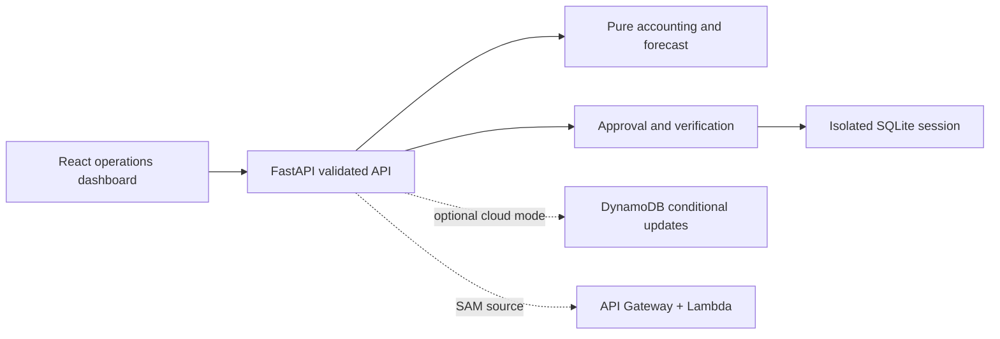

# Architecture and trust boundaries

domain.py owns numerical facts. operations.py owns ingestion, incident state and evidence-bound actions. repository.py serializes SQLite updates and provides conditional DynamoDB revisions. main.py validates HTTP requests and serves the built interface. The browser cannot set incident status, verification counts or success receipts.

Preview changes future assumptions only, never observed readings. Duplicate approval returns the same local receipt. Invalid mutations roll back. DynamoDB retries operate only on session data; no outbound side effects occur inside a retry.

This demo uses session isolation, not real-site authentication. A random HTTP-only cookie identifies each session; mutations also require its CSRF token and an allowed Origin when supplied. Local cookies use SameSite=Lax; cloud config uses Secure, SameSite=None and a precise frontend origin. Browser third-party cookie restrictions may still affect cloud hosting. TTL is enforced on reads even before storage cleanup. Archive packaging excludes database files, cookies and credentials.

The assistant explains computed facts deterministically. An optional webhook adapter is tested against a real local HTTP receiver with success and failure, but is not connected to an external destination. A local inbox receipt cannot establish human acknowledgement, tanker booking or repair.

Tests cover independent arithmetic, chronological availability, freshness, inflow reconciliation, schema rejection, ownership, approval revision/expiry, persistence, concurrent duplicate approval and recovery. Browser checks exercise the built UI. Synthetic evaluation has separate methodology and is not proof of field reliability.
