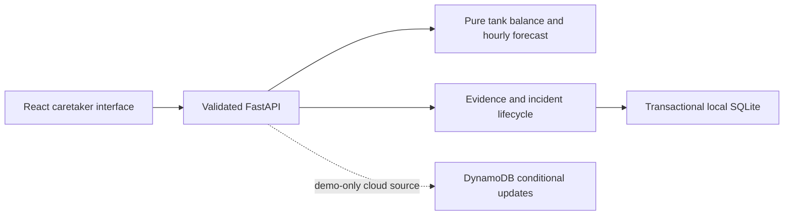

# Architecture and trust boundaries

domain.py owns numerical facts; operations.py owns records, incident facts and evidence-bound actions; repository.py owns persistence and concurrency; main.py validates requests and locality. The browser cannot set incident status, success receipts or verification counts.

Demo sessions use an isolated virtual clock. LOCAL_OBSERVED is available only to loopback peers with SQLite and without JAL_DEMO_ONLY=true. It begins empty and uses UTC server wall time. Recorded inputs are operator-entered, not authenticated sensor measurements. Site timezone drives forecast buckets; the UI currently collects/displays IST. India/UTC work without an external timezone database.

Session cookies are random and HTTP-only. Mutations and exports require CSRF and an allowed Origin when present. This provides local session isolation, not production authentication. Observed sessions expire after30 days without a write; disposable demos default24h. SQLite atomically enforces200 active sessions and300KB payloads; new guest creation is limited per peer to6/minute. DynamoDB source uses an atomic global100/hour creation budget. Its quotas and conditional updates are tested offline; live AWS behavior is unverified.

Imports integrate arrived inflow and observations in a single transaction before analysis. Conflicts roll back. Batch imports cannot manufacture three independent recovery checks. Planned delivery IDs can transition to arrived exactly once. Changed records/settings invalidate outstanding approvals. Reading-error tolerance is bounded by the declared per-reading error; larger unexplained rises remain UNKNOWN.

Stored incident lifecycle is derived from approval, intervention and verified timestamps. UNKNOWN is a view of current data quality and does not erase those facts. Fresh readings restore OPEN, ACTION_REQUESTED or VERIFYING. Unknown/gapped/revised evidence clears recovery counts. Preview/assistant use the validated session snapshot, removing the second-read expiry race.

No outbound send occurs inside retries. Local notice receipts establish only persistence. The optional webhook adapter has local receiver tests and is not connected to a recipient. The assistant explains computed facts deterministically. See EVALUATION.md for independent synthetic reserve timing, censoring, early warnings and detector false alerts.
