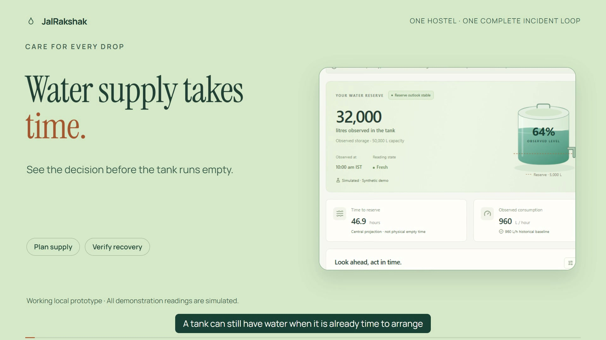

# JalRakshak demonstration videos

The [2:54 narrated demo](media/JalRakshak-Demo.mp4) and [22-second launch clip](media/JalRakshak-Launch.mp4) use the actual October 11 application interface in isolated simulated sessions. Both are 1080p at 30 fps, with quiet original music, narrated audio and captions. Download a file if GitHub does not play it in the page.

The narration is synthetic Kokoro `hm_omega` (a Hindi male preset) with English phonemization. It is not a human recording. Timing/signal checks passed; human listening, naturalness, pronunciation and exact accent quality have not been independently assessed. Listen before uploading. The [SRT captions](media/JalRakshak-Demo.srt) use approximate phrase alignment.

The [raw 47-second interface recording](media/actual-ui-walkthrough.webm) supplements the edited narrative. The repair-claim-only and recorded-arrival setup used bounded local API calls; no claim-only UI button is implied. Actual reading workflow supplied the recovery evidence. All tank readings and site identity are fictional; no real log was imported.

The complete local editable HyperFrames projects, script, voice files, capture evidence and licenses are in `deliverables/brag-output-2026-10-11-182558/` on the creation workspace; that directory is intentionally excluded from Git. The rendered web copies are included here. [Verification](media/video-verification.json) and [media hashes](media/manifest.json) cover these presentation files, not an application ZIP.

The event requires an under-three-minute YouTube video. These files have not been uploaded to YouTube or submitted to the event. Development began October 1; organizer eligibility clarification is still required. Live AWS execution, field accuracy and caretaker usefulness remain unverified. The README links to actual source checks and evaluation limits.

Production used [Brag](https://github.com/latent-spaces/brag) (MIT), [HyperFrames](https://github.com/heygen-com/hyperframes) (Apache 2.0) and [GSAP](https://gsap.com/standard-license/) (its custom No Charge license). Typography uses Manrope and Instrument Serif under their SIL Open Font Licenses. The instrumental music is original; [Kokoro-82M](https://huggingface.co/hexgrad/Kokoro-82M) supplied synthesized narration. The local editable delivery retains the exact software/font notices and media provenance; these videos do not bundle model weights or rendering software.

## Narration transcript

**0:00 — Water supply takes time.**

A tank can still have water when it is already time to arrange the next supply. Jal Rakshak helps one hostel caretaker see that decision before the tank runs empty.

**0:12 — One caretaker. One tank.**

This is a working local prototype for one site. The dashboard connects the latest reading, reserve level, delivery lead time and a clear next action. Every demonstration reading is labeled simulated.

**0:26 — Reserve is not an empty tank.**

The planning deadline comes before the reserve crossing. It subtracts supply lead time and an operating buffer. Reserve breach and empty tank time stay separate, so the caretaker can understand the reason for the recommendation.

**0:42 — Missing evidence stays UNKNOWN.**

An observed workspace starts empty. Missing or stale readings stay unknown. The operator must declare a reading error bound and its basis. A small bound prompts review, and the interface explains that declaration is not calibration.

**0:58 — Compare a plan before acting.**

What if the next supply arrives late? A preview compares that plan without changing the readings. Historical hourly demand informs the outlook, while unconfirmed delivery plans cannot extend the conservative planning deadline.

**1:13 — Notice abnormal depletion.**

In this generated scenario, sustained excess usage opens an incident. The app shows the abnormal depletion and the evidence behind it. It does not pretend to locate a leak or identify a physical fault.

**1:29 — Review. Approve. Keep a record.**

The caretaker reviews the exact notice and explicitly approves it. Approval belongs to this incident and this evidence revision. The receipt means the notice was saved locally. It does not mean a tanker was booked or a supplier was contacted.

**1:46 — A repair claim is not recovery.**

Recording a repair does not close the incident. Recovery needs three fresh independent normal readings after the intervention and adequate planning margin. The activity trail records what happened. New observations support the recovery decision; a button or a message cannot provide that evidence.

**2:06 — Show the evidence. Show the limits.**

The original synthetic holdout has no late reserve predictions. Stress cases still include twelve late predictions, and early warnings and false alerts remain concerns. Tests prove local behavior; they do not prove accuracy on real tanks.

**2:22 — AWS integration source is included.**

The repository includes Lambda, a SAM template, and a boto three Dynamo DB adapter. GitHub checks pass. Live AWS execution remains unverified; this demo uses local SQLite storage.

**2:38 — Make the next water decision clearer.**

Jal Rakshak connects reserve planning, explicit approval and reading supported recovery in one caretaker workflow. The next milestone is a real tank log and caretaker feedback. Explore the public source, run the demo and inspect the evidence.
