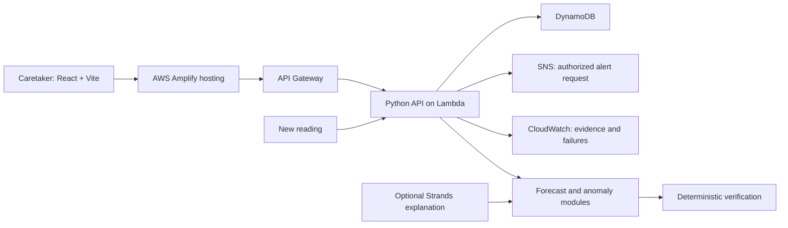

# Proposed project: JalRakshak

Status: planning, October 1, 2026. Nothing below is a claim of implemented functionality.

## Product and user

**JalRakshak tells a hostel caretaker the latest time to act before the water reserve is breached, explains abnormal depletion, and verifies the outcome after an intervention.**

One site, one tank, one manager. A tank percentage and an estimated deadline appear together. The manager can explore a delayed supply, approve a notification, and see whether subsequent observations support recovery. A notification is a request to act; the prototype does not book a tanker, perform a repair, guarantee supply, or operate a pump.

The organizer asks for an environmental number to change a concrete decision. Tanker lead time makes that decision visible. This is a fit judgment; both tanker planning and school-air planning appear among the organizer's suggestions, so neither is an originality claim. [Organizer announcement](https://www.wemakedevs.org/blogs/announcing-environmental-hacks).

## Validate the actual problem before committing

Speak to one real caretaker yourself; Codex must not invent an interview or contact people on your behalf. Ask:

1. How do you measure tank level, and how often?
2. Do you know tank capacity and the unusable reserve?
3. Are inflow and deliveries recorded? Are there submeters?
4. How long does additional supply take, and how much does that vary?
5. What was the most recent shortage or unexplained-use incident?
6. What action would a warning change, and who approves it?
7. Would a manual-reading workflow be usable?

Record actual answers and unknowns. If no reliable readings or meaningful action exist, narrow the product or choose school air. Do not manufacture evidence that a school or hostel uses the prototype.

## Scope

| Priority | Capability | Acceptance proof |
|---|---|---|
| Core | Validated manual/demo observations | Reading persists and changes displayed state |
| Core | Forecast to reserve and action deadline | Hand-computed constant-demand case matches |
| Core | Sustained abnormal depletion | Scenario changes evidence and forecast through ingestion |
| Core | Deterministic recommendation | Evidence, deadline, and proposed action agree |
| Core | Explicit approval and truthful notification status | Unauthorized/stale approval rejected; authorized test receipt recorded |
| Core | Verification after new readings | Repair claim alone cannot resolve incident |
| Core | Usable operations screen and resettable demo | Complete scenario under three minutes |
| Evidence | Baseline evaluation and limitations | Regeneratable artifacts with provenance |
| Preferred | Deployed AWS slice | URL/API/DynamoDB path observed during event |
| Optional | Strands explanation/what-if assistant | Bounded tools; fallback works; actual calls distinguished from scripted tests |

No city map, marketplace, payments, pump control, physical leak localization, complicated 3D, multiple campuses, custom deep learning, unrelated weather feeds, or multi-agent product architecture. Agents may help build the code; the product itself does not need a swarm.

## Numerical contract

Use UTC internally, Asia/Kolkata in the interface. All quantities carry units and provenance. Keep these terms separate:

- `reserve_breach_at`: first time stored volume crosses the configured reserve.
- `empty_at`: first time projected physical storage reaches zero, if it occurs within the modeled horizon.
- `latest_action_at`: earliest conservative reserve-breach estimate minus expected supply lead time minus configured safety buffer.
- `supply_confidence`: observed arrival, confirmed planned supply, unconfirmed plan, or absent supply. A plan is not a delivery.
- `data_state`: fresh, stale, insufficient, or invalid. Provenance and `simulated` are independent fields: a simulated reading can also be stale or insufficient. Stale/insufficient data cannot yield an unconditional SAFE.

If no crossing occurs within the horizon, return `no_breach_within_horizon`, not an infinite guarantee. If demand is unknown, return UNKNOWN. If the deadline has passed, say ACT NOW and expose the missed margin; do not shift it into the future.

Tank balance over a time step:

```text
end_storage = start_storage + recorded_inflow + arrived_deliveries
              - estimated_consumption
```

Start projections at the latest measured volume and its observation time. Add only later inflow not already represented by that measurement. A new measurement replaces the projection anchor; prior arrivals are not added again. Infer consumption between two observations using inflow in that exact interval, with a documented timestamp-boundary convention. Keep other inflow and tanker-delivery ledgers disjoint and identify deliveries idempotently. Display measured volume separately from any estimate of volume now.

Consume each delivery once. Bound physical storage to `[0, capacity]`; track overflow and unmet demand separately instead of allowing negative tank levels. Calculate actual projected shortage duration from unmet demand; time below reserve is a separate planning risk. A delayed or unconfirmed delivery must not conceal risk in the conservative scenario. Do not subtract a separate leak estimate again if observed consumption already includes it.

Tank-level changes without known inflow do not uniquely identify consumption. With only total tank data, report **site-level abnormal depletion**, not “Block B leak.” Only use block-level evidence if genuine/simulated submeter observations are present and visibly labeled. A manual percentage reading has measurement uncertainty; it is not a calibrated sensor.

The earliest credible breach can initially come from explicit low/central/high demand scenarios. Label that a sensitivity envelope, not a statistically calibrated confidence interval. Only introduce a probability or percentile after validation supports its coverage.

## Forecast and evidence

Start with recent-average consumption and same-hour historical median. If justified, compare an EWMA/trend adjustment. Use only history available at each forecast origin. Account for recorded inflow before inferring outflow. Separate scenario truth from the operational data interface.

Split chronologically into training, validation, and final test windows. Prevent target windows overlapping an earlier split. Select methods and thresholds on validation only; preserve final holdout for the report. Do not edit fixtures until a candidate wins.

Report MAE with an exact target/horizon/unit, reserve-breach timing error on events where it is measurable, and the number of censored/no-event windows separately. For anomaly detection report delay, false alerts per monitored site-hours, and missed labeled scenarios. Synthetic holdout results demonstrate behavior on the simulator, not real-world reliability.

Projection comparison must share the starting conditions, seed, exogenous baseline demand/supply, and random draws between intervention and no-intervention branches. Change only the declared intervention effect: a repair may reduce excess consumption; an extra delivery changes inflow. Document those effects as assumptions. Label projected shortage hours avoided and abnormal litres as simulated estimates. Keep aggregate tank estimates distinct from known scenario truth.

## Incident and action contract

An incident has its own states: OPEN → ACTION_REQUESTED → VERIFYING → RESOLVED, with ESCALATED/UNKNOWN when evidence fails. A notification has separate states: PROPOSED → APPROVED → PUBLISHING → PUBLISHED or FAILED; endpoint receipt is RECORDED separately when available. SNS acceptance does not prove human reading, tanker booking, or repair.

Approval binds an authenticated actor, site, action, evidence version, expiry, and idempotency key. Changed/stale facts require a renewed proposal. Keep approval outside the model's tool permissions. Test double clicks and concurrent requests. Expect transport retries and possible duplicate receipt; use stable action identifiers rather than promising exactly-once external delivery.

Resolution requires fresh observations after the intervention, sustained evidence within the configured band, and recomputed adequate reserve margin. Persist the observations used in verification. A repair button records a claim; a demo repair scenario generates subsequent simulated readings through the same ingestion path. The UI cannot directly force RESOLVED.

Notify only a destination the user has authorized. Real outbound proof must show acceptance and, where possible, receipt. If unavailable, show a local integration test and state the limitation plainly. [SNS publish reference](https://docs.aws.amazon.com/sns/latest/api/API_Publish.html), [delivery status](https://docs.aws.amazon.com/sns/latest/dg/sns-topic-attributes.html).

## Proposed architecture



One modular API, one deployed Lambda initially. Local development uses FastAPI and persistent SQLite behind a repository interface. Cloud mode uses DynamoDB; **do not rely on Lambda filesystem/SQLite for persistence**. Use SAM for reproducible infrastructure. Prefer Python 3.13 if current dependencies support it: the local executable exists and AWS lists that runtime. Match local/CI/cloud versions and check packaging on Linux. [AWS runtimes](https://docs.aws.amazon.com/lambda/latest/dg/lambda-runtimes.html).

Protect real-site reads and mutations with authenticated, site-scoped authorization. Public judge access should use disposable simulated state, with quotas and no notification rights. Authenticated owner rehearsals may send clearly labeled simulated test alerts only to a confirmed authorized test destination after concrete approval. Cognito is a candidate managed authentication mechanism; verify its configuration during implementation. Do not put AWS credentials or an admin secret in frontend source.

EventBridge is optional if polling/scheduled recomputation materially helps. Step Functions is optional if the durable incident genuinely needs it. Do not add services just to increase the diagram. A deployment blocked by account verification can fall back to a real AWS open-source implementation under the event rules, with the limitation visible; it cannot masquerade as cloud execution.

## Interface and demo

One operations screen: usable litres, reserve, time to reserve breach, action deadline, next supply status, data age/provenance, one recommendation, and incident history. Put scenario controls in a clearly labeled Demo Lab. Show a tank and two trajectories using lightweight SVG/chart components; explain risk with text and icons as well as color. No decorative landing page consumes the first milestone.

| Seconds | Visible proof |
|---|---|
| 0–15 | Real user/problem; disclose simulated readings |
| 15–40 | Healthy state and meaningful deadline |
| 40–65 | Sustained abnormal depletion changes forecast |
| 65–90 | Six-hour supply delay moves the action margin |
| 90–115 | Approve request and show truthful notification evidence |
| 115–140 | New post-intervention readings support verification |
| 140–160 | Evaluation and one limitation |
| 160–175 | Actual AWS execution/open-source use and closing sentence |

These are proposed timings. Write final narration around the real build, not planned capabilities. Use a 2:45–2:55 recording target to remain under the strict three-minute rule. Record a real screen workflow; any edited cuts must not imply unimplemented behavior.
